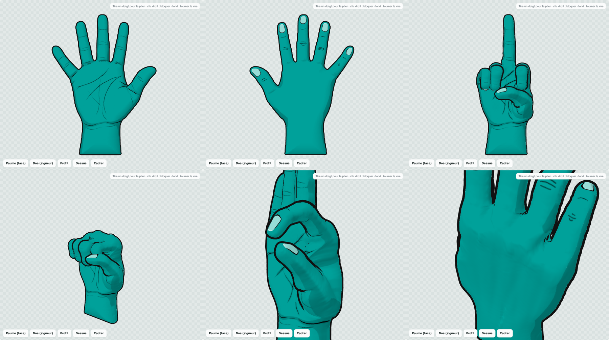
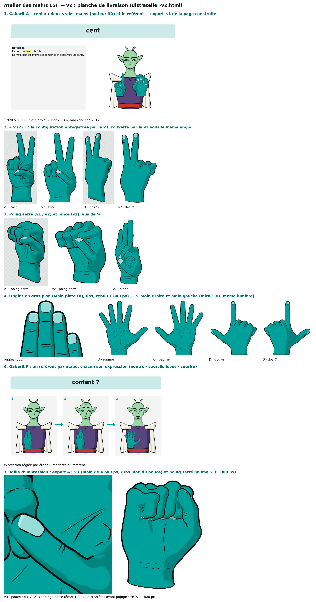

# Atelier des mains LSF

Outil web pour **poser une main en 3D comme une marionnette** et en exporter des images
(PNG à fond transparent) destinées à des supports de classe : fiches de vocabulaire LSF,
planches de signes, leçons de mathématiques.

La main n'est pas un modèle générique : c'est **le dessin de l'auteur**, enseignant LSF natif
(CODA) à l'INJS de Metz, reconstruit en volume. Au repos, le rendu est le dessin d'origine
**exact au pixel près**, face et dos ; tout le reste du logiciel est écrit pour que cela reste
vrai pose après pose.



---

## Ce que l'outil produit

- Une **configuration de main** (les 5 doigts, 4 degrés de liberté chacun) vue sous n'importe
  quel angle : paume, dos du signeur, profil, dessus, ou une orientation libre.
- Une **planche de signe** complète : un référent de face (le corps, parce que l'emplacement
  du signe sur le corps est un paramètre de la LSF), **les deux mains**, un mouvement en
  **plusieurs étapes clés** dont chacune a sa propre configuration de doigts, une **flèche**
  (droite, arc, demi-cercle, vague, zigzag, boucle ; simple ou aller-retour) et un **fond**.
- Un **export PNG** recadré au plus juste, à fond transparent ou sur le fond choisi — prêt à
  être posé dans Canva, un diaporama ou une fiche.
- Un **échange JSON** pour enregistrer, rouvrir et partager une configuration.

## Prendre l'outil en main

1. Ouvrir `dist/atelier-mains-lsf.html` (ou la version en ligne).
2. Onglet **Doigts** : choisir une configuration de départ, puis **tirer un doigt** pour le
   plier. Clic droit sur une articulation pour la **bloquer** (cadenas), Maj + glisser pour ne
   bouger qu'une seule articulation.
3. Onglet **Main** : orientation, deuxième main, miroir.
4. Onglet **Mouvement** : ajouter des étapes clés, régler la flèche, jouer le mouvement.
5. Onglet **Décor** : référent, repères d'emplacement, fond, cadre.
6. Onglet **Biblio** : enregistrer / relire, exporter le PNG.

### Configurations de départ fournies

`Dessin` (le dessin exact) · `Repos` · `Main plate (B)` · `Poing (A)` · `Poing serré` ·
`Index (1)` · `V (2)` · `Trois (3)` · `Quatre (4)` · `Main ouverte (5)` · `L` · `Y` · `C` ·
`O` · `Pince`.

> **Les chiffres au-delà de 5 ne sont pas fournis.** Leurs formes varient d'un usage à
> l'autre et elles n'ont pas été devinées : à poser à la main une fois, puis à ranger dans la
> bibliothèque. Même remarque pour « Trois » et « Quatre », donnés dans la forme française
> courante — à vérifier contre l'usage de l'établissement.

## Ce qui est garanti

- **Anatomie stricte.** Aucune pose impossible : butées articulaires mesurées, couplage du
  fléchisseur profond, asservissement entre doigts voisins, convergence des doigts fléchis
  vers le scaphoïde, et une base du pouce à **deux axes qui ne se croisent pas**
  (Hollister 1992, Imaeda 1994) avec son couplage flexion / abduction / rotation axiale.
- **Pas de traversée.** Un solveur de contacts arrête chaque articulation au contact sans
  jamais faire passer un doigt dans la paume ni dans un autre doigt — y compris pendant la
  lecture d'un mouvement.
- **Pas de déformation.** Un balayage automatique de ~170 poses mesure sur le maillage les
  replis, froissements, triangles pincés ou gonflés, la longueur des phalanges et l'épaisseur
  de la peau. **Aucune phalange ne s'allonge jamais** (0,0 % sur 170 poses).
- **Le repos est le dessin.** Vérifié pixel à pixel à chaque modification du moteur.

## Construire et vérifier

```bash
pip install numpy scipy pillow playwright && playwright install chromium

python3 build.py                   # assemble dist/ à partir de source/hand3d.json
python3 build.py --rig --preview   # régénère la géométrie depuis references/ (~10 s)
python3 tests/rendu.py             # rendus de contrôle  -> tests/out/planche.png
python3 tests/balayage.py          # balayage anti-déformation (~170 poses)
```

`build.py` produit deux fichiers autonomes :
`dist/atelier-mains-lsf.html` (sans doctype, pour claude.ai) et
`dist/atelier-mains-lsf.local.html` (page complète, ouvrable directement dans un navigateur).

## Organisation

```
references/   paume.jpg, dos.png        les deux dessins d'origine — la source de vérité
source/
  rig3d.py      dessins -> géométrie + textures -> hand3d.json  (numpy, scipy, Pillow)
  hand3d.json   données générées, embarquées dans la page
  head.html     interface (Doigts / Main / Mouvement / Décor / Biblio)
  style.css     jetons de couleur clair/sombre
  script.js     moteur 3D (Three.js r128) : squelette, peau, anatomie, contacts, rendu, interface
build.py        assemblage en un fichier unique
tests/          rendus de contrôle et balayage anti-déformation (Playwright, WebGL logiciel)
dist/           page construite
CLAUDE.md       journal technique : ce qui a été mesuré, ce qui a été essayé et rejeté
```

**Lire `CLAUDE.md` avant de toucher au moteur.** Il contient les exigences non négociables,
les approches déjà essayées et écartées (avec la raison), et les mesures qui ont servi à
régler chaque constante. Plusieurs « évidences » y sont démenties par la mesure.

## Limites connues

- Vu en très gros plan, le fond des creux entre deux doigts repliés montre encore des traits
  déchirés (le contour y est légitime mais le fond est rasant). Invisible à l'échelle d'usage.
- La tranche de la main (vue de profil) est déduite, pas dessinée.
- Le glisser est un peu lent sur machine modeste : le test de contacts est appelé plusieurs
  dizaines de fois par mouvement.
- La bibliothèque persistante n'existe que dans l'environnement claude.ai ; ailleurs,
  l'échange JSON prend le relais.

## Couleur

Vert INJS `#00a19a`, relevé sur le logo de lsfdico.injs-metz.fr. C'est la seule chose qui
change par rapport aux dessins d'origine.

---

## v2 — l'atelier de conception (en cours de validation)

La v2 est une application NOUVELLE, construite à côté de la v1 (dans `v2/`), qui ne touche à rien de la v1.
Une page autonome : `dist/atelier-v2.html` (pour claude.ai) et `dist/atelier-v2.local.html` (à ouvrir dans un navigateur).



**Ce qui change** : la main est un volume anatomique (maillage MakeHuman CC0 retaillé aux proportions de l'auteur,
26 610 sommets, ongles mesurés), rendue en 3D (aplat vert INJS, ombre franche, contour noir, ongles clairs), 77
configurations (les 15 de la v1, l'alphabet, les chiffres 0–5, des formes de base) ; et autour d'elle un éditeur de
planche « comme Canva » : plusieurs mains (droites ou gauches, miroir 3D), textes surlignés, images de l'ordinateur en
objet ou en fond, flèches, un référent (buste sans bras, quatre expressions), gabarits (A bannière + définitions,
B carte, C fiche A4, D 4 étapes, E bilingue, F étapes avec un référent par étape), export PNG ×1/×2/×3 à fond
transparent possible, projet JSON (aussi caché dans le PNG), brouillon local, bibliothèque claude.ai.

### Architecture
```
v2/
  hand/        M1 — la main : pipeline Python (MakeHuman → retaille → Catmull-Clark → ongles → poids) → hand_v2.glb + .json
  engine/      M2 — moteur Three.js r128 : pose, skinning DQ + correctifs, toon 4 passes, marionnette, contacts, presets
  plate/       M3 — éditeur de planche (document v9, calques, texte, images, gabarits, export, projet, bibliothèque)
  personnage/  M4 — le référent (chemins SVG → Path2D, expressions, vue de dos)
  build.py     assemble la page unique (three.js vendu, GLB en base64, polices OFL en base64 : aucun CDN)
  tests/       Playwright : engine_*, plate_*, personnage, integration_* ; images dans tests/out/
  */JOURNAL.md chaque chantier : ce qui a été mesuré, essayé, écarté
```

### Construire et vérifier
```bash
python3 v2/build.py                                   # → dist/atelier-v2.html + .local.html (≈ 5 Mo), node --check
python3 <run_rendu.py> v2/tests/integration_parcours.py   # parcours complet sur la page construite
python3 <run_rendu.py> v2/tests/integration_lateralite.py # main D/G, miroir 3D, orientation
python3 <run_rendu.py> v2/tests/integration_v1.py         # reprise des configurations v1, db, downloads
python3 <run_rendu.py> v2/tests/integration_cache.py      # cache des mains au vrai coût de rendu
python3 <run_rendu.py> v2/tests/integration_livraison.py  # → v2/tests/out/livraison_v2.png
```
(`run_rendu.py` sert three.js en local pour la page v1 ; les tests v2 n'en ont besoin que pour les captures v1.)

### Publier
Republier `dist/atelier-v2.html` (sans doctype : claude.ai l'ajoute) avec les capacités `db`, `user`, `downloads` et
`assets`. Republiée sur l'artifact de la v1, la v2 lit ses « configurations » (onglet Projet → « Configurations de la
v1 ») et enregistre ses planches dans « projets ». Une ligne de la bibliothèque ne peut pas dépasser 256 Kio (contrat
`db`) : une planche plus lourde envoie ses photos par `assets` et ne garde dans la ligne que leur identifiant ; sans
`assets` (personne qui ne peut pas modifier l'artifact), elle est enregistrée sans ses photos, et la page le dit.

### Ce qui reste
Voir `v2/PLAN.md` § « État d'avancement » : critique multi-regards, validation par l'utilisateur (expressions,
chiffres 6–10, presets « à valider »), temps à remesurer sur sa machine (mesurés en rendu logiciel).
